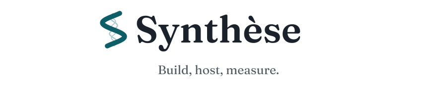
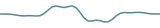
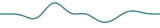
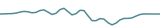
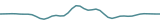
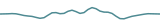

  <a href="https://synthe.se">
    <picture>
      <source media="(prefers-color-scheme: dark)" srcset="https://raw.githubusercontent.com/synthe-se/.github/main/profile/assets/banner-dark.svg">
      <source media="(prefers-color-scheme: light)" srcset="https://raw.githubusercontent.com/synthe-se/.github/main/profile/assets/banner-light.svg">
      
    </picture>
  </a>

   

  **[synthe.se](https://synthe.se)** · [Services](https://synthe.se/services) · [Work](https://synthe.se/work) · [Status](https://synthe.se/status) · [Contact](https://synthe.se/contact)

 

Synthèse is an independent workshop in France. It builds websites and applications, hosts them on infrastructure it runs itself, and engineers tools for audio, vision and measure. Fifteen years of craft, screwdriver to signal.

- **Rigour**: verified, measured, documented.
- **Sobriety**: few dependencies, few words, few watts.
- **Sovereignty**: independent infrastructure, open tools.

## In the open

<table>
  <tr>
    <td width="190">
      <a href="https://github.com/synthe-se/maison"><b>Maison</b></a> 
      
    </td>
    <td>The whole home, driven locally: one Rust binary on a 2012 Raspberry Pi 1, about 18 MB of RAM, every device reached on the LAN, passkeys at the door.</td>
  </tr>
  <tr>
    <td>
      <a href="https://github.com/synthe-se/clapier"><b>Clapier</b></a> 
      
    </td>
    <td>A Nabaztag:tag revival: one binary serves the 2006 rabbit its brain, its sounds and its dances, with a web app to watch and drive the whole burrow.</td>
  </tr>
  <tr>
    <td>
      <a href="https://github.com/synthe-se/synthboard"><b>Synthboard</b></a> 
      
    </td>
    <td>A swipe keyboard for Android that keeps what you type to itself: French and English at once, a 178 KB network on the CPU, zero permissions. In active development.</td>
  </tr>
  <tr>
    <td>
      <a href="https://github.com/synthe-se/uniseal"><b>Uniseal</b></a> 
      
    </td>
    <td>Old Logitech Unifying receivers, given a second life as the key of a small file vault. Rust, SDL2, real crypto.</td>
  </tr>
  <tr>
    <td>
      <a href="https://github.com/synthe-se/frame-kernel"><b>frame-kernel</b></a> 
      
    </td>
    <td>Mainline Linux for a Frameo photo frame: kernel, device tree, Buildroot system and signed updates. It turns the frame into Maison's wall screen.</td>
  </tr>
</table>

Each project carries its own signature: a small additive synthesis, seeded by its name.

From the same bench, at [uplg](https://github.com/uplg): [Hora](https://github.com/uplg/hora), the lightweight uptime monitor that watches [synthe.se](https://synthe.se/status); [Iris](https://github.com/uplg/iris), a home media library in Rust; and [nabgcc](https://github.com/uplg/nabgcc), the firmware that teaches the rabbit WPA2 and WPA3.

## On the bench

- **[Elara](https://synthe.se/work/elara)**, the house CMS: Astro and Rust, Stripe payments, a live chat that reaches the team on Matrix. It powers [ezako.com](https://ezako.com), [dobruniadesign.com](https://dobruniadesign.com) and [artmineral.fr](https://artmineral.fr). The open source release comes with V1.
- **[Ariane](https://synthe.se/work/ariane)**, the thread of a home or a team: a journal that converges offline, a Rust core shared with the browser in wasm.
- **[achi](https://synthe.se/work/achi)**, the e-reader companion: Rust firmware for the ESP32-C3 and a small mascot with kind words.
- **[Paperasse](https://synthe.se/work/paperasse)**, the copilot and memory of a firm's procedures.

## Work together

A conversation first, then a written quote. Answers within one business day: [synthe.se/contact](https://synthe.se/contact).
